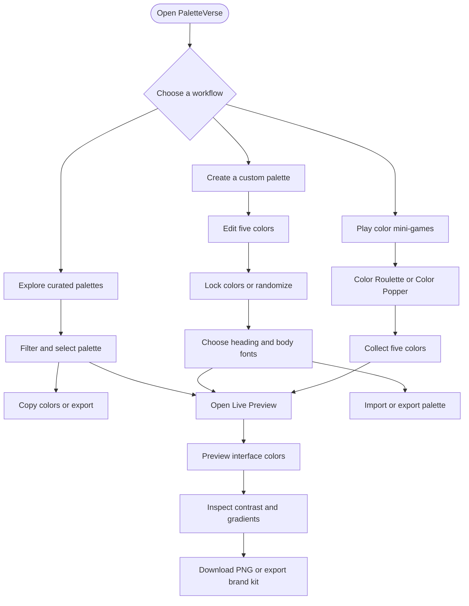
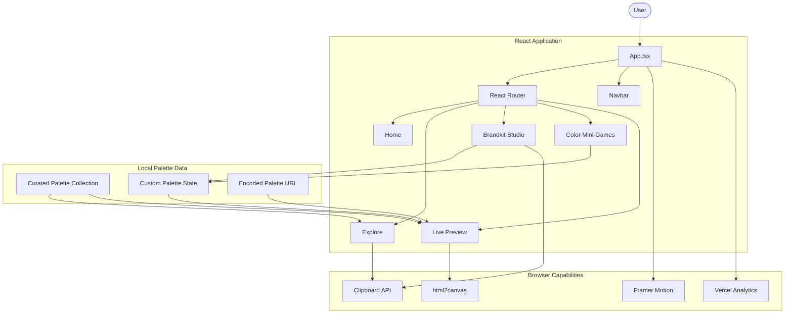
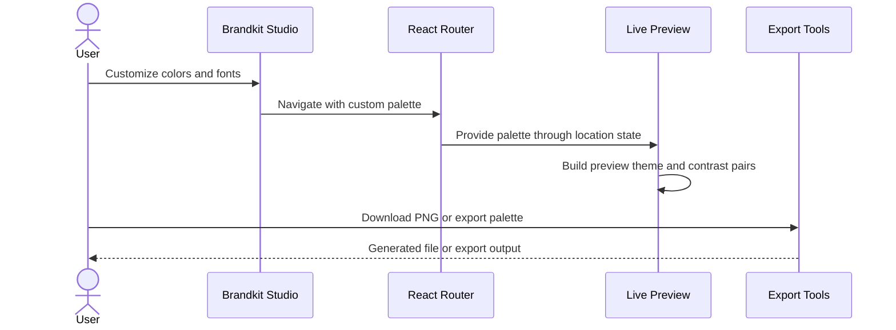

<div align="center">
  
  <h1>PaletteVerse</h1>
  <p>Discover colors. Create palettes. Build beautiful interfaces.</p>
</div>
PaletteVerse is an interactive color palette and brand-kit playground designed for UI/UX designers, frontend developers, and creative builders. Explore curated color combinations, generate custom palettes, experiment with typography, preview colors in interface mockups, and discover new combinations through playful color mini-games.

🌐 **Live Demo:** [palette-verse.vercel.app](https://palette-verse.vercel.app/)
📦 **Repository:** [github.com/Komalgiri/PaletteVerse](https://github.com/Komalgiri/PaletteVerse)

---

## ✨ Overview

https://github.com/Komalgiri/PaletteVerse/raw/main/src/assets/pv.mp4

*PaletteVerse Demo Video*

Choosing the right colors is one of the most important parts of creating a consistent visual identity. PaletteVerse brings palette discovery, customization, brand-kit experimentation, and interface previews together in one interactive experience.

Instead of simply generating a list of colors, PaletteVerse lets you explore how colors work together, experiment with typography, evaluate contrast, test visual combinations, and export palettes for use in design and development workflows.

**What makes PaletteVerse different?**
- 🎨 Curated palettes organized by mood and color style.
- 🛠️ An interactive workspace for creating custom five-color palettes.
- 🔤 Typography customization with separate heading and body fonts.
- 🖥️ Live previews that show colors in interface mockups.
- ♿ Contrast calculations and color-vision simulation filters.
- 🎮 Mini-games that turn palette discovery into an interactive experience.
- 📤 Palette export, color copying, and shareable palette data.
- ✨ Animated transitions and a polished, responsive interface.

---

## 🚀 Features

### 1. Explore Curated Palettes
Discover color combinations through a visual palette gallery.
- Browse the curated palette collection.
- Filter by mood and tone, including Dark, Light, Warm, Cool, Neon, Pastel, Earth, Monochrome, Vibrant, Muted, Aesthetic, and Vintage.
- Copy individual HEX color codes.
- Open a palette in the live-preview workspace.
- Export palette data through the export interface.
- View palettes using animated cards and color swatches.

### 2. Brandkit Studio — Create Your Own Palette
Build and customize a five-color palette from scratch.
- Edit colors with interactive color pickers.
- Rename individual color roles.
- Lock selected colors so randomization preserves them.
- Generate new combinations with the Randomize action.
- Import HEX colors from pasted text or JSON containing color values.
- Choose heading and body typography independently.
- Send your palette directly to the live-preview sandbox.
- Export your custom palette.

The default five-color structure represents a useful design-system foundation:

| Color position | Typical role |
| --- | --- |
| Color 1 | Darkest text or foreground |
| Color 2 | Dark or secondary color |
| Color 3 | Primary or accent color |
| Color 4 | Surface or component background |
| Color 5 | Lightest background |

These roles provide a starting point and can be adapted to individual projects.

### 3. Live Preview Sandbox
Explore how a selected palette might look when applied to a user interface.
- Preview curated palettes.
- Open palettes created in Brandkit Studio.
- Inspect color combinations in interface mockups.
- Review foreground and background contrast ratios.
- Explore different gradient combinations.
- Simulate selected color-vision conditions.
- Copy generated CSS gradient declarations.
- Download a palette visualization as a PNG.
- Export the current brand kit.

**Accessibility and contrast tools**
PaletteVerse calculates contrast ratios using relative luminance and supports visual filters for:
- Normal vision
- Protanopia — red-vision deficiency simulation
- Deuteranopia — green-vision deficiency simulation
- Tritanopia — blue-vision deficiency simulation
- Achromatopsia — monochromatic vision simulation

*Contrast values can help identify potentially difficult color combinations. The calculations and simulations are useful design aids, not a substitute for comprehensive accessibility testing.*

### 4. Play & Discover
Discover colors through two interactive mini-games.

**Color Roulette**
- Spin a wheel containing 40 color segments.
- Choose between Vibrant, Dark, Soft, and Light themes.
- Collect colors from successive spins.
- Build a five-color palette.
- Open the resulting palette in the live-preview workspace.

**Color Popper**
- Play a bubble-popping color game.
- Discover randomly generated colors as bubbles appear.
- Collect five colors you like.
- Turn your collected colors into a custom palette for further experimentation.

These mini-games make palette generation more exploratory than a conventional random-color button.

### 5. Palette Sharing and Export
PaletteVerse provides several ways to take your work beyond the editor.
- Copy HEX color values.
- Export palette or brand-kit information.
- Download a palette visualization as a PNG.
- Copy generated CSS gradient styles.
- Open a palette encoded in a shareable URL.

The live-preview page supports encoded palette data through the `p` query parameter. The palette information is encoded in the URL rather than retrieved from a server-side palette database.

### 6. Motion and Interactive UI
The interface uses animated page transitions and component-level motion to create a more engaging workflow.
- Animated route transitions.
- Staggered palette-card appearances.
- Animated color pillars.
- Interactive modals.
- Hover states and visual feedback.
- A responsive layout for browsing and editing palettes.

---

## 🧭 Application Routes
The application uses React Router to navigate between its primary experiences.

| Route | Page | Purpose |
| --- | --- | --- |
| `/` | Home | Landing page and introduction |
| `/explore` | Explore | Browse, filter, copy, preview, and export palettes |
| `/create` | Creator | Build a custom palette and select typography |
| `/play` | Play | Discover colors through mini-games |
| `/live-preview` | Live Preview | Preview palettes, inspect contrast, test gradients, and export |

---

## 🔄 User Workflow
The following diagram illustrates the main ways a user can work with PaletteVerse.



---

## 🏗️ Architecture
PaletteVerse is a client-side React application built with TypeScript and Vite. Its page components use local React state to manage interactions, while palette definitions are imported from the project's local palette data module.



**Architecture principles**
- **Component-based UI:** Reusable React components keep the interface modular.
- **Route-based organization:** Each primary experience has its own page.
- **Local palette data:** Curated palettes are imported from `src/data/palettes.ts`.
- **State-driven customization:** React state manages color edits, color locks, typography, filters, and mini-game progress.
- **URL-based palette transfer:** Selected and custom palettes can be passed between pages through navigation state; shared palettes can also be encoded in a URL.
- **Browser-based export:** html2canvas renders a palette element to an image for download.
- **Lightweight deployment:** Vite produces a static frontend build suitable for static hosting.

---

## 🧰 Tech Stack

| Technology | Purpose |
| --- | --- |
| React 19 | UI components and rendering |
| TypeScript | Type safety |
| Vite | Development server and production builds |
| React Router 7 | Client-side navigation |
| Framer Motion | Animations and transitions |
| Lucide React | Interface icons |
| Three.js | 3D graphics library |
| React Three Fiber | React renderer for Three.js |
| React Three Drei | Helpers for React Three Fiber |
| html2canvas | Exporting UI elements as images |
| Vercel Analytics | Website analytics |
| Oxlint | Code linting |
| Prettier | Code formatting |

*The Three.js ecosystem is included in the dependencies for 3D-related capabilities; its presence does not imply that every page uses 3D rendering.*

---

## 📁 Project Structure
The primary application structure is organized around pages, reusable components, palette data, and styling.

```text
PaletteVerse/
├── public/
│   └── favicon.png
├── src/
│   ├── assets/
│   │   └── logo.png
│   ├── components/
│   │   ├── home/
│   │   │   └── Hero.tsx
│   │   ├── layout/
│   │   │   ├── Navbar.tsx
│   │   │   └── PageTransition.tsx
│   │   └── ExportModal.tsx
│   ├── data/
│   │   └── palettes.ts
│   ├── pages/
│   │   ├── Home.tsx
│   │   ├── Explore.tsx
│   │   ├── Creator.tsx
│   │   ├── Play.tsx
│   │   └── LivePreview.tsx
│   ├── App.tsx
│   ├── main.tsx
│   └── index.css
├── index.html
├── package.json
├── package-lock.json
├── tsconfig.json
├── vite.config.ts
└── README.md
```

**Key files**
- `src/App.tsx` — application shell, route definitions, navigation, and analytics.
- `src/main.tsx` — React entry point.
- `src/data/palettes.ts` — curated palette definitions and palette types.
- `src/pages/Explore.tsx` — gallery filtering, color copying, preview navigation, and export interactions.
- `src/pages/Creator.tsx` — palette customization, locking, randomization, typography, and import/export controls.
- `src/pages/Play.tsx` — color roulette and color-popper game logic.
- `src/pages/LivePreview.tsx` — interface previews, contrast calculations, gradients, color-vision filters, and image export.
- `src/components/layout/Navbar.tsx` — main navigation.
- `src/components/layout/PageTransition.tsx` — page-transition wrapper.
- `src/components/ExportModal.tsx` — palette export interface.
- `vite.config.ts` — Vite configuration and React plugin.

---

## ⚙️ Getting Started

### Prerequisites
Install the following before running the project:
- Node.js compatible with the installed Vite version.
- npm.
- Git.

Verify your installation:
```bash
node --version
npm --version
git --version
```

### 1. Clone the repository
```bash
git clone https://github.com/Komalgiri/PaletteVerse.git
cd PaletteVerse
```

### 2. Install dependencies
```bash
npm install
```

### 3. Start the development server
```bash
npm run dev
```
Open the local URL printed by Vite in your browser.

### 4. Build for production
```bash
npm run build
```
This runs TypeScript project builds followed by the Vite production build.

### 5. Preview the production build
```bash
npm run preview
```

### 6. Run linting
```bash
npm run lint
```

---

## 📜 Available Scripts

| Command | Description |
| --- | --- |
| `npm run dev` | Starts the Vite development server |
| `npm run build` | Runs TypeScript build checks and generates production assets |
| `npm run lint` | Runs Oxlint |
| `npm run preview` | Serves the production build locally |

---

## 🎨 Palette Data Model
The curated palette collection is defined in `src/data/palettes.ts`.

A palette contains properties such as an identifier, display name, five colors, color names, typography settings, and category tags.

A simplified example of the data structure is shown below:
```typescript
type Palette = {
  id: string;
  name: string;
  colors: string[];
  colorNames?: string[];
  headingFont?: string;
  bodyFont?: string;
  tags: string[];
};
```
*This is an illustrative schema. Refer to `src/data/palettes.ts` for the project's actual exported type definition.*

The five-color structure allows the application to map colors to foreground, accent, surface, and background roles when constructing previews.

---

## 🔗 How Palette Sharing Works
The application supports transferring palettes between different parts of the experience.



The preview page can also read encoded palette information from the `p` query parameter. Invalid encoded data is ignored by the current implementation.

---

## ♿ Accessibility Considerations
PaletteVerse includes tools that help designers evaluate color combinations:
- Relative-luminance-based contrast ratios.
- Several color-vision simulation filters.
- Clear HEX values for repeatable color selection.
- Semantic page structure and interactive controls.

*When using PaletteVerse for production interfaces, independently verify WCAG contrast requirements, keyboard navigation, focus visibility, and screen-reader behavior in the resulting design.*

---

## 🌍 Deployment
PaletteVerse is configured as a Vite frontend and includes Vercel Analytics.

For a typical static deployment:
1. Push the project to GitHub.
2. Import the repository into a static hosting provider.
3. Set the build command to `npm run build`.
4. Set the output directory to `dist`.
5. Configure the hosting provider to serve the app's entry point for client-side routes.
6. Deploy and verify the `/explore`, `/create`, `/play`, and `/live-preview` routes.

The existing project metadata references [palette-verse.vercel.app](https://palette-verse.vercel.app/). Confirm the deployment is active before treating it as the current production release.

---

## 🧪 Quality and Testing
The repository includes a lint command and a production build command. Before a release, validate the following workflows manually or with automated tests:
- Browse and filter palettes.
- Copy HEX values to the clipboard.
- Randomize colors while preserving locked colors.
- Import valid HEX values and handle invalid input.
- Transfer custom palettes into Live Preview.
- Test Color Roulette and Color Popper.
- Calculate contrast ratios for selected color pairs.
- Copy CSS gradients and download a PNG.
- Open a shared palette URL.
- Verify navigation and direct loading of nested routes.
- Run linting and the production build.

---

## 🔮 Future Enhancements
Potential areas for future development include:
- Save and organize favorite palettes.
- Add search and advanced filtering.
- Support exporting design tokens as CSS variables, JSON, and Tailwind configuration.
- Expand color-harmony and palette-generation algorithms.
- Add more detailed WCAG accessibility reports.
- Add a dedicated contrast checker for arbitrary foreground/background pairs.
- Introduce shareable, editable palette links with validation.
- Add automated unit and end-to-end tests.
- Improve accessibility and keyboard navigation throughout the application.

*These are proposed improvements, not claims about existing functionality.*

---

## 🤝 Contributing
Contributions, suggestions, and bug reports are welcome.
1. Fork the repository.
2. Create a feature branch.
3. Make your changes.
4. Run the lint and build commands.
5. Test the affected workflows.
6. Submit a pull request with a clear explanation of the changes.

For bug reports, include reproduction steps, expected behavior, actual behavior, and relevant browser-console output.

---

## 📄 License
No explicit project license has been verified. Add a `LICENSE` file and update this section once the intended license has been selected.

---

## 👩‍💻 Author
**Komal Giri**
- GitHub: [@Komalgiri](https://github.com/Komalgiri)
- Portfolio: [portfolio-komalgiri.onrender.com](https://portfolio-komalgiri.onrender.com/)
- LinkedIn: [Komal Giri](https://www.linkedin.com/in/komal-giri-52798a265/)
